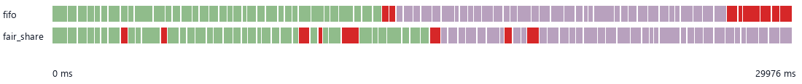

# GPU Inference Scheduler

[](https://github.com/jacobzychowicz/Optimizing-GPU-Inference-Scheduling/actions/workflows/tests.yml)
[](LICENSE)

**Which request should the GPU run next?** This tool replays realistic inference traffic through different scheduling policies, simulated or live on a real GPU (local or over SSH), and shows who waited.

It started with a voice-cloning narration app, [RecapVox](docs/results.md). A long script becomes hundreds of TTS requests at once, and with first-come-first-served, another user's one-line retake waits behind all of them:



| scheduler | retake wait (mean) | script segments (mean) | throughput |
| --- | ---: | ---: | ---: |
| fifo | 13.8 s | 10.7 s | same |
| **fair_share** | **0.65 s (21× faster)** | 12.3 s | same |

<sub>Simulated `narration-small` workload; see [docs/results.md](docs/results.md) for the full comparison and the live GPU run.</sub>

**What it does**
- **Simulate** in milliseconds from a model's runtime formula, or **calibrate** that formula from a real GPU run so the simulation matches the hardware.
- **Live on GPU**: replays arrivals in real time on a real backend (voice-cloning XTTS-v2, your own Python model or server process, or a PyTorch load generator) and samples GPU busy % and memory.
- **Over SSH**: runs on any Linux GPU server with Python 3.8+. Nothing gets installed there. Log in with keys or a saved password.
- **Generates traffic**: narration bursts and retakes, or steady, bursty, and ramping request streams.
- **Desktop app** (PySide6, with a Windows .exe and a Linux binary) with charts, a per-request timeline, history, and CSV/JSON/PNG export, plus a full CLI.

Scheduling is non-preemptive and request-level: whenever the GPU is free, the scheduler picks which waiting request runs next.

## Setup

### 1. Get the app

| You want | Do this |
| --- | --- |
| Windows app | Download `GPU-Inference-Scheduler.exe` from [Releases](https://github.com/jacobzychowicz/Optimizing-GPU-Inference-Scheduling/releases/latest) and double-click it. Nothing else to install. |
| Linux app | Download `GPU-Inference-Scheduler-linux-x86_64.tar.gz` from [Releases](https://github.com/jacobzychowicz/Optimizing-GPU-Inference-Scheduling/releases/latest), then `tar xzf GPU-Inference-Scheduler-linux-x86_64.tar.gz` and `./GPU-Inference-Scheduler-linux-x86_64`. Runs on Ubuntu 20.04+ / Debian 11+ and similar. |
| Everything (any OS) | `git clone https://github.com/jacobzychowicz/Optimizing-GPU-Inference-Scheduling.git` with Python 3.8+ installed. |

Both apps open the desktop window when started with no arguments, and take the same commands as `python -m gpu_bench` when given arguments, for example `GPU-Inference-Scheduler.exe hosts test gpu-box` or `./GPU-Inference-Scheduler-linux-x86_64 token-mix --live`. On a Linux machine with no display, the Linux app opens the terminal menu instead of the window. Both can run on an SSH server (Linux or macOS with Python 3.8+), with key or password login; the Windows app uses the built-in Windows OpenSSH client for key logins. The window on Linux needs the usual Qt desktop libraries (on Ubuntu: `sudo apt install libxcb-cursor0 libegl1`); the command line needs nothing.

### 2. Install what you need (Python install only)

The command line works with no packages at all. Add only what you use:

| Package | Needed for | Install |
| --- | --- | --- |
| PySide6 | the desktop window | `pip install -r requirements-gui.txt` (installs all three) |
| paramiko, keyring | SSH hosts that log in with a password | |
| PyTorch | live runs of `synthetic-gpu` or `xtts` on that machine | [pytorch.org](https://pytorch.org/get-started/locally/) (choose a CUDA build) |
| coqui-tts | the `xtts` voice-cloning model, on the GPU machine | `pip install coqui-tts`, then accept the [model license](https://coqui.ai/cpml) by setting `"agree_to_cpml": true` in `defaults/models/xtts.json` |

### 3. Check it works

```
python -m gpu_bench narration-small fifo fair_share retake_first   # simulation: prints a comparison table
python -m gpu_bench gpus                           # lists GPUs, driver, and PyTorch/CUDA
python -m gpu_bench gui                            # opens the window
```

On Linux/macOS you can also `chmod +x gpu-bench` and use `./gpu-bench` in place of `python -m gpu_bench`.

### 4. Run on a GPU

**This machine** (NVIDIA + CUDA PyTorch, or Apple MPS):

```
python -m gpu_bench token-mix --model synthetic-gpu --live --repeat 3
```

**The narration benchmark** (on the GPU machine, or add `--host NAME`):

```
python -m gpu_bench generate narration-busy --users 4 --segments 100 300 --retakes 20 --model xtts
python -m gpu_bench narration-busy fifo shortest_predicted fair_share retake_first --model xtts --live --repeat 3 --save
python -m gpu_bench calibrate 1 --save     # fit the simulator to the GPU; prints simulated-vs-live error
```

**A remote server**: needs SSH access and Python 3.8+ on a Linux/macOS server. Nothing is installed there: each run copies the app over, runs it, streams results back, and cleans up.

```
# Key login (uses your ssh keys, agent, and ~/.ssh/config). Connect once with `ssh` first to accept the host key.
python -m gpu_bench hosts add gpu-box alice@10.0.0.5 --python /opt/venv/bin/python

# Password login: asked each time, or --save-password to keep it in Windows Credential Manager / Keychain
python -m gpu_bench hosts add lab bob@lab.example.edu --password --save-password

python -m gpu_bench hosts test gpu-box                                   # connect and show its GPUs
python -m gpu_bench token-mix --model synthetic-gpu --live --host gpu-box --save
```

In the window, the same steps are under **Run on → Manage hosts... → Test connection**.

Notes:
- Key logins on Windows need the OpenSSH client (Settings → Optional features).
- A password login shows a new server's key fingerprint once and asks you to trust it. A saved password the server rejects is deleted, and you're asked again.
- For scripts with no terminal, set `GPU_BENCH_SSH_PASSWORD`.
- The packaged apps have no PyTorch, so `synthetic-gpu` and `xtts` run live only on SSH hosts (or from a Python install). Worker backends need Python installed.

## Using it

**Desktop window**: choose **Run on** (this computer or a host), **Simulate** or **Live on GPU**, then a workload, a model, and schedulers, and press **Run**.
- **Results** shows a table (with retake and script-segment rows when the workload has kinds), the best scheduler for each metric, and a timeline (hover for details). **Calibrate model...** fits the simulator to a live run.
- **Charts** shows latency bars and a latency distribution curve. **Save as PNG...** exports them.
- **Jobs** lists every request, **Log** shows progress, and **History** keeps every run automatically. Export CSV/JSON from Results or History.
- **New workload...** generates traffic. **Add file...** brings in your own workloads, models, or schedulers.

**Terminal menu**: `python -m gpu_bench` with no arguments, in a terminal.

**Commands**:

```
python -m gpu_bench list                          workloads, models, schedulers
python -m gpu_bench <workload> [scheduler ...]    compare
    -m NAME       model (default: the workload's own)
    -s A,B        only these schedulers
    --live        live run (default: simulate)
    --repeat N    live: average over N runs
    --host NAME   saved host, or user@host[:port]
    --save        keep in history
    --out FILE    write .json, or .csv summary
    --json        print the full result as JSON
python -m gpu_bench gpus [--host NAME]
python -m gpu_bench hosts [list | add | remove | test]
python -m gpu_bench history [list | show N | export N FILE]
python -m gpu_bench generate NAME [--preset narration|traffic] ...
python -m gpu_bench calibrate N [--save]
```

A file path works anywhere a name works. Add `-h` to any command for every option.

## Your own files

Put them in `~/.gpu_bench/workloads`, `models`, or `schedulers` and they appear by name next to the samples. That folder also holds saved hosts, history, trusted server keys, and settings; set `GPU_BENCH_HOME` to move it. Passwords are never written there.

**Workload**: requests arriving over time.

```json
{ "name": "my-load", "model": "example-tts",
  "jobs": [ { "id": "a", "arrival_ms": 0, "user": "alice", "kind": "retake", "priority": 2,
              "predicted_duration_ms": 400, "input": { "text": "One line to fix." } } ] }
```

`priority`: higher runs first (missing means 0). `predicted_duration_ms`: what a scheduler sees before a request runs. `input`: what the model reads. `user` and `kind` are optional: schedulers can use them (`fair_share` balances users), and reports break latency down by `kind`. Or generate a workload with `generate`.

**Scheduler**: one function. Don't modify `ready`.

```python
def select(ready, now_ms):
    return min(ready, key=lambda job: job["arrival_ms"])
```

**Model**: `runtime` is used for simulation; `backend` (optional) runs requests for real in live mode. Without a backend, a live run just waits for the formula's time, which is a quick way to test a setup or host.

```json
{ "name": "my-model",
  "runtime": { "base_ms": 30, "per_token_ms": 25, "token_field": "max_tokens" },
  "backend": { "type": "python", "module": "my_backend.py", "config": { "device": "cuda" } } }
```

`runtime` takes `per_token_ms` + `token_field`, or `per_character_ms` + `text_field`. Backends:

- **python**: a file with `load(config) -> state` and `infer(state, job)`, plus optional `warmup(state)` and `close(state)`. `infer` must block until the GPU work finishes (`torch.cuda.synchronize()`). Start from `defaults/backends/torch_matmul.py`.
- **worker**: `{"type": "worker", "command": ["python", "serve.py"], "cwd": "/srv/model"}`. This is a long-running process in any language. It prints `{"ready": true}` once loaded, then answers each `{"job": {...}}` line with `{"ok": true}` or `{"error": "..."}`. Start from `defaults/backends/worker_example.py`.

Paths are relative to the model file. For SSH runs, relative backend files are copied over automatically; use an absolute `cwd` for code that already lives on the server.

## Samples

| | |
| --- | --- |
| Workloads | `narration-small` (2 scripts + 8 retakes from other users), `mixed-lengths`, `priority-mix`, `token-mix` |
| Models | `example-tts`, `example-llm` (formula only), `xtts` (real voice cloning, XTTS-v2), `synthetic-gpu` (PyTorch GPU load), `example-worker` (worker template) |
| Schedulers | `fifo`, `shortest_predicted`, `priority`, `aging`, `fair_share` (smallest backlog per user first), `retake_first` (earliest deadline: retakes 2 s, segments 10 min) |

## What a run reports

Per scheduler: mean and p95 latency (arrival to finish), mean wait, and jobs/s, overall and per request `kind`. Live runs add GPU busy % and peak memory (NVIDIA), plus the spread across repeats.

Typical trade-offs: shortest-job wins on average latency but makes long requests wait; strict priority can starve low-priority work; aging balances the two.

## Development

```
python -m unittest discover tests                  # tests
pip install pyinstaller -r requirements-gui.txt && python build.py   # app for this OS, in dist/
```

`build.py` makes `GPU-Inference-Scheduler.exe` on Windows and `GPU-Inference-Scheduler-linux-x86_64` on Linux (PyInstaller can't cross-compile, so build each on its own OS). The `release` workflow builds both on GitHub: run it from the Actions tab to download them, or push a tag (`git tag v1.0.0 && git push --tags`) to attach them to a Release.

```
python docs/make_images.py [result.json]           # regenerate the icon and README images
```

Planned: batching and concurrent slots per GPU, preemptive and dynamic policies.
