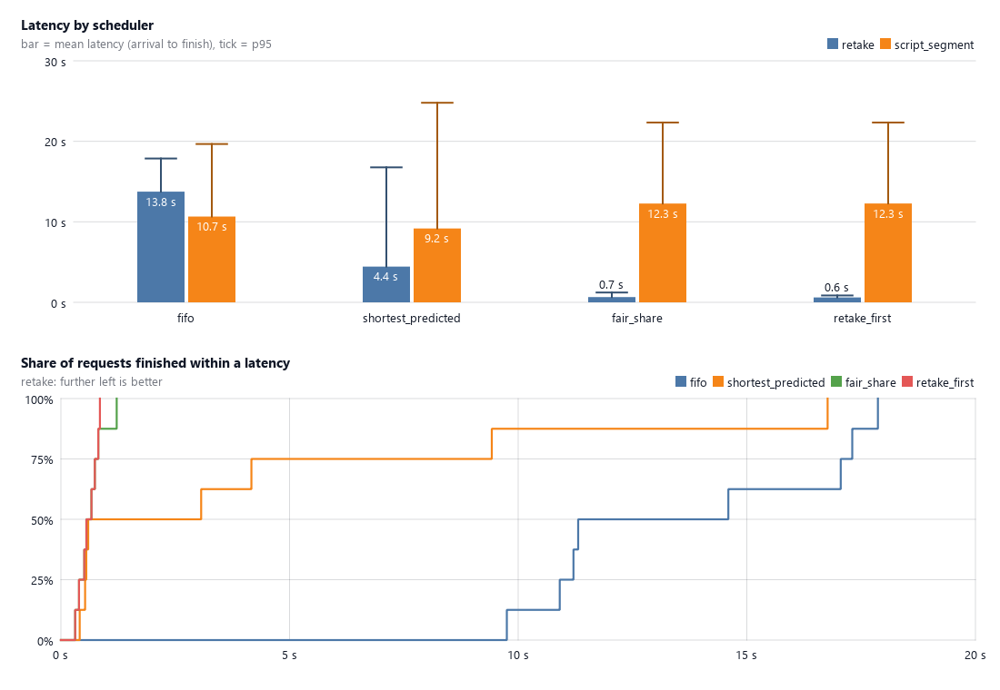
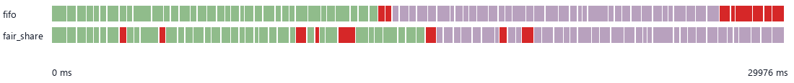

# Results: one-line retakes vs 40-minute scripts

## The problem

A voice-cloning narration app (RecapVox) splits each script into one TTS request per sentence. When a creator pastes a long script, hundreds of requests reach the GPU at once. When another creator retakes a single line, they sit waiting for one short request. With first come, first served, that retake waits behind every sentence of every script ahead of it.

## Simulation (no GPU)

`narration-small`: 2 users submit scripts (70 sentences total), and a third user makes 8 single-line retakes while the scripts are being voiced. The model is `example-tts` (40 ms + 3 ms per character).

```
python -m gpu_bench narration-small fifo shortest_predicted fair_share retake_first
```

| scheduler | retake mean | retake p95 | script segment mean | all requests mean |
| --- | ---: | ---: | ---: | ---: |
| fifo | 13.8 s | 17.9 s | 10.7 s | 11.0 s |
| shortest_predicted | 4.4 s | 16.8 s | 9.2 s | 8.7 s |
| **fair_share** | **0.65 s** | **1.2 s** | 12.3 s | 11.1 s |
| **retake_first** | **0.61 s** | **0.9 s** | 12.3 s | 11.1 s |

- With `fair_share`, retakes finish **21× sooner** than with `fifo` (13.8 s → 0.65 s). Script segments finish 15% later on average, and throughput is unchanged: the GPU does the same work in a different order.
- `shortest_predicted` looks best on the overall average, but a retake's wait still swings from 0.4 s to 17 s, depending on whether a long sentence is ahead of it.
- `retake_first` (earliest deadline first) matches `fair_share` for retakes and still lets segments run once they near their own deadline, so neither side starves.




## Live on a GPU (fill in after the server run)

```
python -m gpu_bench hosts test gpu-box
python -m gpu_bench generate narration-busy --users 4 --segments 100 300 --retakes 20 --model xtts
python -m gpu_bench narration-busy fifo shortest_predicted fair_share retake_first \
    --model xtts --live --repeat 3 --host gpu-box --save
python -m gpu_bench calibrate 1 --save          # how well the simulator matches this GPU
python -m gpu_bench history export 1 docs/live.json
python docs/make_images.py docs/live.json       # charts from the live run
```

| | |
| --- | --- |
| GPU | _e.g. NVIDIA A100 40GB_ |
| Model | Coqui XTTS-v2, voice cloning |
| Workload | _N_ users, _N_ script sentences, _N_ retakes |
| Repeats | 3 |

| scheduler | retake mean | retake p95 | script segment mean | GPU busy |
| --- | ---: | ---: | ---: | ---: |
| fifo | | | | |
| shortest_predicted | | | | |
| fair_share | | | | |
| retake_first | | | | |

Calibration: _base_ ms + _slope_ ms per character, R² _x_. The calibrated simulator predicted the live mean latency within _x_%.
